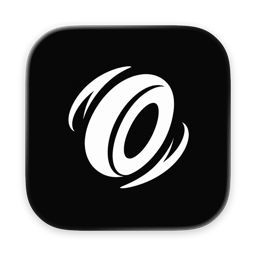
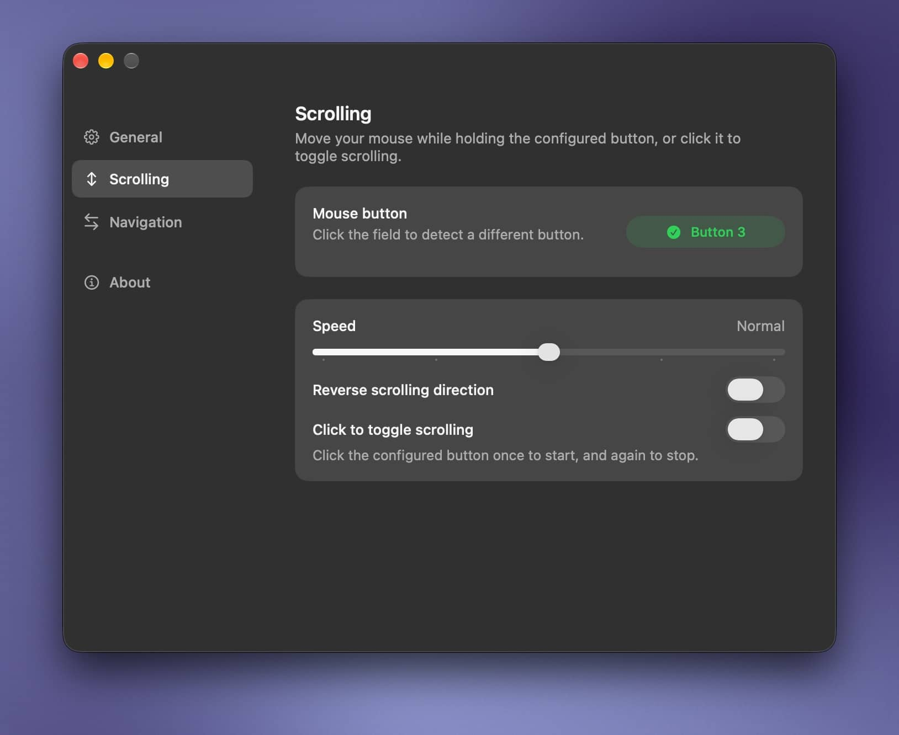
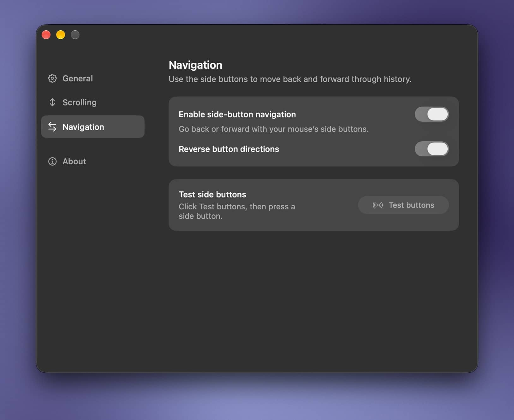
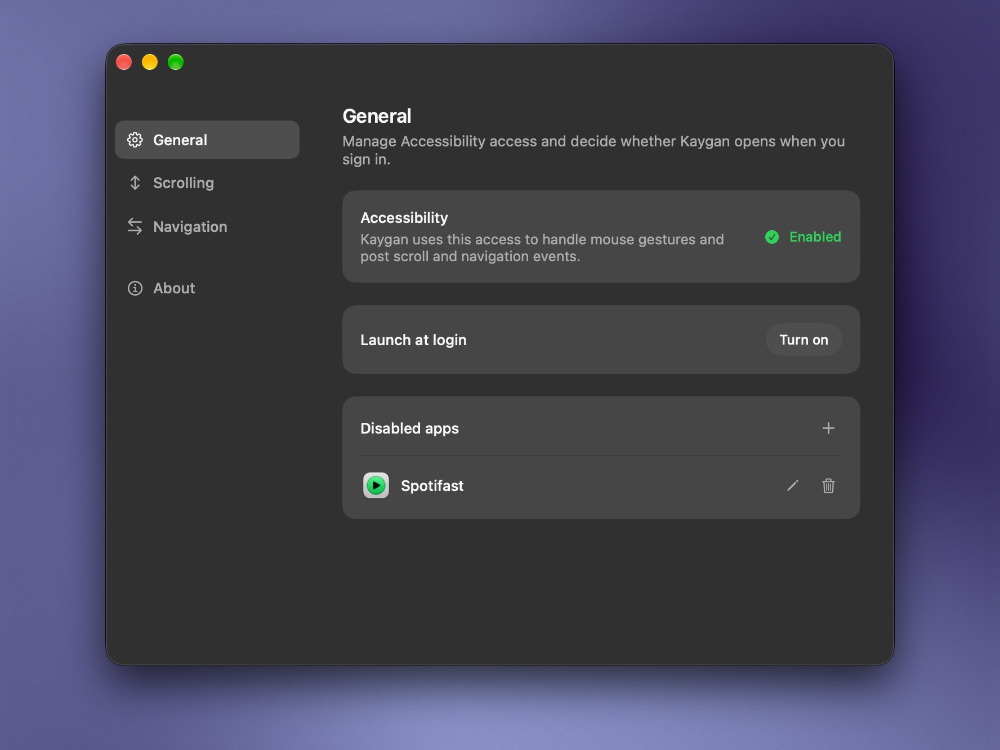

<div align="center">
  
  <h1>Kaygan</h1>
  <p><strong>A smoother, more natural mouse experience.</strong></p>
  <p><a href="https://github.com/aerz/Kaygan.app/releases/latest">Download</a> &nbsp;·&nbsp; <a href="#getting-started">Getting started</a> &nbsp;·&nbsp; <a href="#build-from-source">Build from source</a></p>
</div>

Hold a mouse button and move to scroll. Use the side buttons to go back and forward.

<p align="center">
  
</p>

## What you can do

- **Scroll in any direction.** Hold your chosen button or click to toggle, then move your mouse.
- **Go back and forward.** Use your side buttons in apps that support navigation gestures.
- **Set your pace.** Adjust scrolling speed and direction.
- **Choose your apps.** Disable scrolling, navigation or both per app.

Changes in Settings apply immediately.

<p align="center">
  <a href="docs/images/03-navigation.jpeg"></a>
  <a href="docs/images/01-general.jpeg"></a>
</p>

## Getting started

Requires macOS 15 or later and a mouse with a middle or side button. Download a DMG from [GitHub Releases](https://github.com/aerz/Kaygan.app/releases) or [build from source](#build-from-source).

1. Open the DMG and drag Kaygan into Applications.
2. Open Kaygan from Applications. If macOS blocks it, open System Settings → Privacy & Security and select Open Anyway.
3. Open Settings from the menu bar icon.
4. Click General → Request Access. Enable Kaygan in System Settings → Privacy & Security → Accessibility. Enabled confirms access to handle mouse gestures and send scroll and navigation events.
5. In Scrolling, click Mouse button and press your preferred middle or side button. The default is Button 3, usually the middle button. Hold it and move to scroll.

If you built Kaygan from source, start at step 3. Release downloads use a self-signed certificate and are not notarized by Apple.

For a downloaded copy that you trust, you can remove its quarantine attribute after copying it to Applications:

```sh
xattr -rd com.apple.quarantine "/Applications/Kaygan.app"
```

This command does not grant Accessibility access. Complete the permission step in System Settings.

Check side buttons in **Navigation → Test buttons**. **Buttons 4 and 5** go back and forward; a button assigned to scrolling takes priority.

By default, clicking the scrolling button without moving the mouse keeps its normal action in the app, such as opening a link or closing a tab. Moving while holding it scrolls without triggering a click. Enable **Scrolling → Disable normal button actions** to reserve the button for scrolling, including when **Click to toggle scrolling** is enabled.

## Build from source

Use **Xcode 27** and [XcodeGen](https://github.com/yonaskolb/XcodeGen). The app targets macOS 15 and later; the Xcode project is generated from [`project.yml`](project.yml).

```sh
brew install xcodegen
xcodegen generate
open Kaygan.xcodeproj
```

In Xcode, select the **Kaygan** scheme and **My Mac**, then run the app. Kaygan starts in the menu bar without opening a window.

For a signed build, use your existing signing identity. If your development team differs from the one in `project.yml`, update `DEVELOPMENT_TEAM` there and regenerate the project.

<details>
<summary>Command-line builds and tests</summary>

```sh
xcodebuild -project Kaygan.xcodeproj -scheme Kaygan build
xcodebuild -project Kaygan.xcodeproj -scheme Kaygan test
```

</details>

## Package a release

The [Package Kaygan workflow](.github/workflows/package.yml) runs the tests, builds and signs the app, and creates the DMG using [package.sh](.github/scripts/package.sh). It uploads the DMG and `SHA256SUMS` in an artifact named after the source commit.

If you do not have a release certificate, create one in Keychain Access → Certificate Assistant → Create a Certificate. Name it `Kaygan Release Signing`. Select Self Signed Root and Code Signing, and use the login keychain. Enable the override for defaults to set the validity period to 3650 days.

In My Certificates, export the certificate and its private key as a password-protected `.p12` file. Keep the file and password outside the repository. Reuse this certificate for each release so that macOS can recognize the app between versions.

If you already have a release certificate, reuse its `.p12` file.

Add two repository secrets under Settings → Secrets and variables → Actions. Set `SIGNING_CERTIFICATE_P12` to the Base64-encoded `.p12` file. Set `SIGNING_CERTIFICATE_PASSWORD` to the password for that file.

To copy the encoded certificate to the clipboard, run:

```sh
base64 -i "/path/to/Kaygan Release Signing.p12" | pbcopy
```

The workflow runs when you push to the `release` branch. Commit your changes to `main`, then sync the remote `release` branch:

```sh
git push origin main:release
```

Follow the run in Actions → Package Kaygan. The workflow uses Xcode 27 and removes the temporary signing keychain when it finishes. After reviewing the artifact, upload the DMG and `SHA256SUMS` to a GitHub release manually.

Download and extract the artifact. From the directory that contains both files, run:

```sh
shasum -a 256 -c SHA256SUMS
```

Before publishing, install the app and grant Accessibility access. Close it, replace it with the next build, and make sure that scrolling and navigation work without granting access again. Changing the signing certificate or bundle identifier requires a new permission grant.

## License

Kaygan is free and open source under the [GNU General Public License, version 3 or later](LICENSE). You can use, study, change and share it under the terms of that license.
